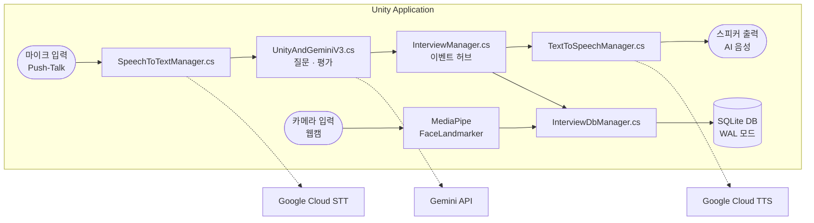
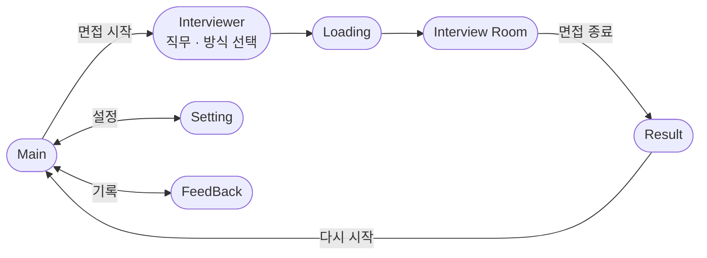

<div align="center">

# AI 면접 코칭 시스템

[](https://unity.com/)
[](https://unity.com/)
[](https://ai.google.dev/)
[](https://www.sqlite.org/)
[](https://mediapipe.dev/)

**AI가 면접관이 되어 실시간으로 피드백을 제공하는 Unity 기반 가상 면접 코칭 시스템**

음성 인식 · 표정 분석 · 발화 습관 감지까지, 면접 준비의 모든 것을 한 곳에서.

</div>

---

## 목차

1. [주요 기능](#주요-기능)
2. [시스템 아키텍처](#시스템-아키텍처)
3. [씬 흐름](#씬-흐름)
4. [기술 스택](#기술-스택)
5. [설치 및 환경 설정](#설치-및-환경-설정)
6. [API 키 설정](#api-키-설정)
7. [프로젝트 구조](#프로젝트-구조)
8. [팀원](#팀원)
9. [개발 규칙](#개발-규칙)

---

## 주요 기능

| 기능 | 설명 | 사용 기술 |
|------|------|-----------|
| 음성 인식 (STT) | 면접자의 음성을 텍스트로 변환 | Google Cloud STT (ko-KR) |
| AI 면접관 | 대화 맥락에 맞는 질문 생성 및 면접 진행 | Gemini 3.5 Flash-Lite |
| 음성 합성 (TTS) | AI 면접관의 답변을 음성으로 출력 | Google Cloud TTS (ko-KR-Wavenet-C) |
| 표정 분석 | 표정 · 시선 · 얼굴 각도를 측정해 태도 점수 산출 | MediaPipe FaceLandmarker |
| 발화 습관 감지 | 간투사(어, 음, 아 등)를 자동으로 감지해 집계 | FillerWordDetector (자체 구현) |
| 면접 결과 리포트 | 음성 · 내용 · 태도 영역별 점수와 개선 피드백 제공 | SQLite, View_Session_Report |
| 기록 관리 | 면접 기록 저장 · 조회 · 삭제 | SQLite (WAL 모드) |

---

## 시스템 아키텍처



### 코어 설계 패턴

Singleton과 Observer(C# 정적 이벤트)를 함께 쓰는 구조입니다. `InterviewManager`가 이벤트 허브 역할을 하고, 각 기능은 이벤트를 통해서만 서로 연결됩니다.

| 이벤트 | 전달 대상 | 처리 내용 |
|--------|-----------|-----------|
| `OnInterviewStarted` | InterviewResultSaver | DB 세션 시작 |
| `OnTranscriptReceived` | UnityAndGeminiV3 | 음성 인식 결과를 Gemini로 전송 |
| `OnGeminiResponseReceived` | TextToSpeechManager | AI 답변 음성 재생 |
| `OnEvaluationReceived` | InterviewResultSaver | 평가 결과 저장 |
| `OnInterviewEnded` | UIManager | Result 씬으로 전환 |
| `OnInterviewEndRequested` | UnityAndGeminiV3 | 종료 정리 처리 |

---

## 씬 흐름



| 씬 | 역할 | 주요 스크립트 |
|----|------|---------------|
| Main | 앱 진입점, 메뉴 | UIManager.cs |
| Interviewer | 면접 직군 · 방식 선택 | UIManager.cs |
| Loading | 면접실 진입 전 대기 | 없음 (씬 전환만 수행) |
| Interview Room | 면접 진행 | InterviewManager.cs, UnityAndGeminiV3.cs, fass.cs |
| Result | 점수 및 피드백 표시 | Result.cs, InterviewDbManager.cs |
| Setting | API 키 입력, 마이크 설정 | SettingsManager.cs |
| FeedBack | 지난 면접 기록 조회 | InterviewDbManager.cs |

---

## 기술 스택

### 엔진 및 플랫폼

| 항목 | 내용 |
|------|------|
| Unity | 2022.3.21f1 LTS |
| 렌더 파이프라인 | Built-in Render Pipeline |
| 타겟 플랫폼 | Windows Standalone (x64) |
| 스크립팅 런타임 | .NET Standard 2.1 |
| C# | 9.0 |

### 외부 패키지

| 패키지 | 용도 | 설치 방법 |
|--------|------|-----------|
| [gilzoide/unity-sqlite-net](https://github.com/gilzoide/unity-sqlite-net) | SQLite ORM | Package Manager (Git URL) |
| [MediaPipe Unity Plugin](https://github.com/homuler/MediaPipeUnityPlugin) | 얼굴 랜드마크 감지 | `LocalPackages/` (tgz) |
| Newtonsoft Json | JSON 직렬화 | Package Manager |
| TextMeshPro | 한국어 UI 텍스트 (NotoSansKR 폰트) | Package Manager |
| FMOD | 오디오 엔진 | Package Manager |

### 외부 API

| API | 용도 | 모델 / 언어 |
|-----|------|-------------|
| Google Cloud STT | 음성 → 텍스트 | ko-KR (최신 모델) |
| Gemini API | AI 면접관, 답변 평가 | gemini-3.5-flash-lite |
| Google Cloud TTS | 텍스트 → 음성 | ko-KR-Wavenet-C (남성) |

### 데이터베이스

| 이름 | 종류 | 주요 컬럼 |
|------|------|-----------|
| Interview_Session |  테이블  | session_id, job_category, session_status, end_time, duration_seconds, conversation_log |
| Session_Result |  테이블  | session_id, score_audio, score_content, score_attitude, total_score, eval_audio_text, advice_audio_text, eval_content_text, advice_content_text, summary_text, advice_text |
| View_Session_Report | 뷰 | 위 두 테이블을 LEFT JOIN한 결과 조회용 |

---

## 설치 및 환경 설정

### 사전 요구 사항

- [Unity Hub](https://unity.com/download)
- Unity **2022.3.21f1 LTS** 에디터 (다른 버전은 MediaPipe 호환 문제가 생길 수 있으니 이 버전을 사용하세요)
- Windows 10 / 11 (x64)
- 웹캠, 마이크

### MediaPipe 패키지 설치

[MediaPipe Unity Plugin](https://github.com/homuler/MediaPipeUnityPlugin)은 파일 크기 문제로 저장소에 포함되어 있지 않습니다. 공식 Releases에서 직접 받아 설치합니다.

1. [Releases 페이지](https://github.com/homuler/MediaPipeUnityPlugin/releases)에서 `.tgz` 파일을 다운로드합니다.
2. 프로젝트 루트의 `LocalPackages/` 폴더에 복사합니다.
3. Unity에서 **Window → Package Manager → + → Add package from tarball...** 을 선택하고 해당 tgz 파일을 지정합니다.

### Build Settings 씬 등록

**File → Build Settings** 에 아래 순서대로 씬을 추가합니다.

| 번호 | 씬 파일 |
|------|---------|
| 0 | `Assets/Scenes/Main.unity` |
| 1 | `Assets/Scenes/Interviewer.unity` |
| 2 | `Assets/Scenes/Loading1.unity` |
| 3 | `Assets/Scenes/InterviewRoom.unity` |
| 4 | `Assets/Scenes/Result.unity` |
| 5 | `Assets/Scenes/Setting.unity` |
| 6 | `Assets/Scenes/FeedBack.unity` |

### 인코딩 설정

모든 C# 스크립트는 **UTF-8 BOM(서명 있음)** 으로 저장해야 합니다. 그렇지 않으면 한글 주석과 문자열이 깨집니다.

Visual Studio 기준으로 **파일 → 다른 이름으로 저장 → 저장 버튼 옆 ▼ → 인코딩하여 저장 → `Unicode(UTF-8 서명 있음)`** 을 선택합니다.

---

## API 키 설정

> [!WARNING]
> API 키는 코드에 직접 쓰거나 Git에 올리지 마세요.
> 앱 실행 후 **Setting 씬**에서 직접 입력하며, 키는 메모리에만 보관되어 앱을 종료하면 사라집니다.

### 필요한 API 키

| API | 발급처 | 입력 위치 |
|-----|--------|-----------|
| Gemini API Key | [Google AI Studio](https://aistudio.google.com/) | Setting 씬 → Gemini API Key |
| Google Cloud API Key | [Google Cloud Console](https://console.cloud.google.com/) | Setting 씬 → Google Cloud API Key |

### Google Cloud에서 활성화할 API

Google Cloud Console의 **API 및 서비스**에서 아래 두 가지를 사용 설정합니다.

- Cloud Speech-to-Text API
- Cloud Text-to-Speech API

### 마이크 선택

Setting 씬의 **마이크 선택** 드롭다운에서 사용할 마이크를 고르면 `PlayerPrefs`에 저장됩니다.

---

## 프로젝트 구조

```
Assets/
├── HJS/                              한종수: AI 파이프라인
│   ├── GeminiManager/
│   │   └── UnityAndGeminiV3.cs       Gemini 통신, 평가 파싱, 503 재시도
│   ├── HJS_scripts/
│   │   ├── SpeechToTextManager.cs
│   │   ├── TextToSpeechManager.cs
│   │   ├── FillerWordDetector.cs     간투사 감지
│   │   ├── SoundManager.cs           BGM / 효과음 싱글턴
│   │   ├── SettingsManager.cs        API 키 메모리 관리
│   │   └── AudioConverter.cs
│   ├── InterviewManager.cs           이벤트 허브
│   ├── InterviewResultSaver.cs       DB 저장 통합
│   └── InterviewMuteController.cs
│
├── SMS/                              신모세: 표정 분석
│   └── MediaPipeUnity/
│       └── fass.cs                   얼굴 랜드마크 → 태도 점수
│
├── HHJ/                              한효준: UI
│
├── LJH/                              이재혁: SQLite DB
│   └── InterviewDb/
│       ├── InterviewDbManager.cs     DB CRUD, 캐시, 스레드 안전
│       ├── SchemaBootstrapHardened.cs  DDL, 트리거
│       └── Models/
│
├── Scenes/                           씬 파일
└── LocalPackages/                    MediaPipe tgz (Git 미포함)
```

---

## 팀원

| 이름 | 역할 | 담당 영역 |
|------|------|-----------|
| 한종수 | 팀장 | AI 파이프라인(STT → Gemini → TTS), 전체 아키텍처, 프로젝트 관리 |
| 신모세 | 팀원 | MediaPipe 표정 · 시선 · 얼굴 각도 분석, 태도 점수 산출 |
| 한효준 | 팀원 | Unity UI 구현, 씬 레이아웃 설계, 씬 내 기능 스크립트 작성 |
| 정재웅 | 팀원 | UX/UI 기획 |
| 이재혁 | 팀원 | SQLite DB 설계, 스키마 및 뷰 구현 |

---

## 개발 규칙

<details>
<summary><b>Git 커밋 컨벤션</b></summary>

<br/>

형식: `타입(범위): 변경 내용 요약`

| 타입 | 용도 |
|------|------|
| Init | 최초 설정 |
| Feat | 새 기능 추가 |
| Fix | 버그 수정 |
| Refactor | 기능 변경 없는 코드 구조 개선 |
| Style | 포매팅 등 코드 동작과 무관한 수정 |
| Docs | 문서 수정 |
| Chore | 빌드, 패키지 등 기타 |

```
Feat(HJS): Gemini 503 에러 지수 백오프 재시도 로직 추가
Fix(SMS): SaveToDatabase 파라미터 float→int 타입 불일치 수정
Refactor(LJH): InterviewDbManager ExecuteSafe 메인스레드 즉시 실행 보장
```

</details>

<details>
<summary><b>브랜치 전략</b></summary>

<br/>

- `main` 브랜치는 PR로만 병합합니다. 직접 push는 금지입니다.
- 작업 브랜치 이름: `feat/작업명/이니셜` (예: `feat/gemini-retry/HJS`, `feat/result-ui/HHJ`)
- `main`에 Branch Protection을 적용해, PR 필수 및 1명 이상의 리뷰 승인이 필요합니다.
- 병합이 끝난 작업 브랜치는 삭제합니다.

</details>

<details>
<summary><b>코드 작성 규칙</b></summary>

<br/>

- 모든 C# 파일은 UTF-8 BOM(서명 있음, 코드 페이지 65001)으로 저장합니다.
- API 키를 코드에 직접 쓰지 않습니다.
- API 키를 `PlayerPrefs`에 저장하지 않습니다. 레지스트리에 평문으로 노출됩니다.
- 씬 간 통신은 `InterviewManager`의 정적 이벤트를 사용하고, 직접 참조하지 않습니다.
- 새 싱글턴은 `SingletonBase<T>`를 상속합니다.

</details>

---

<div align="center">

캡스톤 프로젝트 2조 · 2026

</div>
